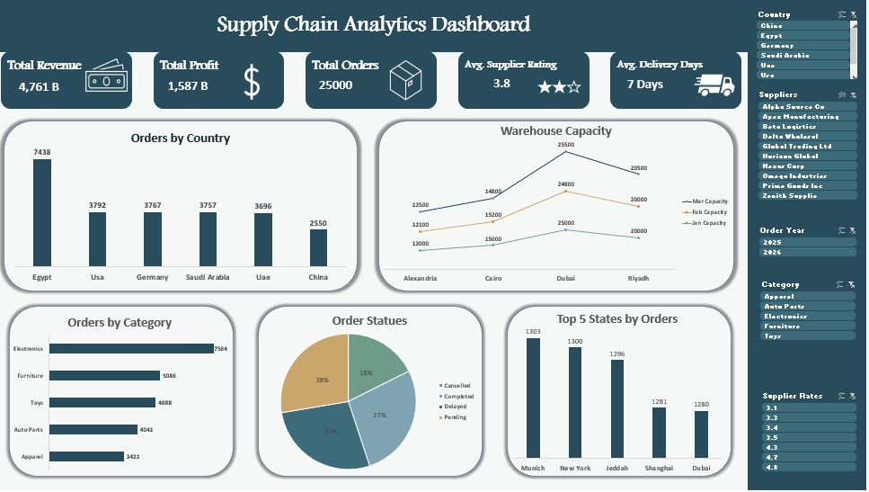

# Supply Chain Analytics Dashboard | Excel

## Project Overview
This project analyzes supply chain order data using Microsoft Excel (Power Query, Power Pivot, Pivot Tables, and Slicers) to understand revenue and profit, order volume by country and category, order fulfillment status, delivery performance, supplier quality, and warehouse capacity.

The main goal is to transform messy raw operational data into a clean, interactive dashboard that helps supply chain and operations teams monitor key KPIs and explore the business by country, supplier, category, year, and supplier rating.

## Dataset Description
The analysis is based on a star-schema dataset stored in `Supply_Chain_Analytics_Dataset_Modified_2.xlsx`, which contains one fact table and four dimension tables:

| Sheet | Rows | Description |
|---|---|---|
| Fact_Orders | 25,100 rows × 21 columns | Order-level data: dates, quantities, costs, prices, shipping cost, status, revenue, and profit |
| Dim_Products | 50 rows | Product name, category, sub-category, reorder level, and lead time |
| Dim_Suppliers | 10 rows | Supplier name, country, rating, and contract terms |
| Dim_Warehouses | 4 rows | Warehouse name, city, and monthly capacity (Jan, Feb, Mar in m³) |
| Dim_Locations | 20 rows | Customer locations (city and country) |

**Fact_Orders columns:** Order_ID, Order_Date, Ship_Date, Expected_Delivery_Date, Product_Key, Supplier_Key, Warehouse_Key, Customer_Location_Key, Quantity_Ordered, Quantity_Received, Quantity_Delivered, Unit_Cost, Selling_Price, Shipping_Cost, Order_Status, System_Timestamp, Created_By, Total_Revenue, Total_Cost, Total_Profit, Fulfillment_Rate.

**Dataset scope:** **25,000 unique orders** placed between **January 2025 and May 2026**, across **50 products**, **5 categories**, **10 suppliers**, **4 warehouses**, and **6 customer countries** (Egypt, USA, Germany, Saudi Arabia, UAE, China).

## Tools Used
- Microsoft Excel
- Power Query (data cleaning and transformation)
- Power Pivot / Data Model (relationships between fact and dimension tables, distinct count measures)
- Pivot Tables
- Slicers
- Charts and Data Visualization

## Project Workflow

### 1. Data Understanding
- Reviewed the fact table and the four dimension tables and the keys that link them (Product_Key, Supplier_Key, Warehouse_Key, Customer_Location_Key).
- Identified data quality issues in the raw data before starting the analysis.

### 2. Data Cleaning & Preparation (Power Query)
The raw dataset contained several intentional data quality problems, which were handled as follows:

- **Duplicates:** Removed 14 fully duplicated rows and the remaining repeated Order IDs, reducing 25,100 rows to **25,000 unique orders**.
- **Inconsistent text:** Trimmed extra spaces, fixed capitalization, and removed special characters from names (for example, supplier names such as `Beta Logistics#$*` became `Beta Logistics`, and `  egypt ` became `Egypt`).
- **Order status:** Standardized 11 inconsistent spellings and cases (such as `cAnCeLeD` and `Canceled`) into 4 clean statuses: Pending, Delayed, Completed, and Cancelled.
- **Dates:** Order, ship, and delivery dates were stored as numeric codes (for example, `90802025`) and were converted into proper date fields, including a `Fixed Order Date` column.
- **Missing values:** 750 orders had a missing `Shipping_Cost`, and these were set to 0.
- **Dimension tables:** Cleaned the Products, Suppliers, Warehouses, and Locations tables, and split the combined location text into separate **City** and **Country** columns.
- **New calculated column:** `Real Delivery Days` = Delivery Date − Order Date.
- Loaded all cleaned tables into the Excel Data Model and linked them through their keys.

### 3. Data Analysis Using Pivot Tables
Created Pivot Tables (in the `PV` sheet) to answer specific business questions:

| Question | Analysis |
|---|---|
| What is the total revenue? | Sum of Total_Revenue |
| What is the total profit? | Sum of Total_Profit |
| How many orders are there? | Distinct count of Order_ID |
| What is the average supplier rating? | Average of Supplier_Rating |
| What is the average delivery time? | Average of Real Delivery Days |
| Orders by country | Distinct count of Order_ID by customer country |
| Warehouse capacity | Jan, Feb, and Mar capacity by warehouse city |
| Orders by category | Distinct count of Order_ID by product category |
| Order status distribution | Distinct count of Order_ID by status |
| Top 5 cities by orders | Top 5 customer cities by distinct Order_ID |
| Profit by year | Sum of Total_Profit by order year |

### 4. Dashboard Development
Organized the Pivot Tables into a single interactive dashboard containing:
- **5 KPI cards:** Total Revenue, Total Profit, Total Orders, Avg. Supplier Rating, Avg. Delivery Days.
- **5 charts:** Orders by Country, Warehouse Capacity, Orders by Category, Order Status, Top 5 States by Orders.
- **5 Slicers:** Country, Suppliers, Order Year, Category, and Supplier Rates, all connected so the user can filter every visual at once.

## Dashboard Preview

## Key Findings

- The dataset contains **25,000 orders** generating total revenue of about **4.76 billion** and total profit of about **1.59 billion** (a profit margin of roughly 33%).
- **Egypt** receives the most orders (7,438, about 30% of the total), while **China** receives the fewest (2,550). The other four countries are close to each other, between 3,696 and 3,792 orders.
- **Electronics** is the top category with 7,564 orders (about 30%), followed by Furniture (5,086), Toys (4,888), Auto Parts (4,041), and Apparel (3,421).
- Only about **27% of orders are Completed**. Pending (28%) and Delayed (27%) orders are each as large as the completed group, and **17.6%** of orders were Cancelled.
- The average delivery time is **6.5 days (about 7 days)** from order date to delivery date.
- The average supplier rating is **3.8 out of 5**, with individual suppliers ranging from 3.1 to 4.8.
- The top 5 cities by orders are very close to each other: **Munich** (1,303), **New York** (1,300), **Jeddah** (1,296), **Shanghai** (1,281), and **Dubai** (1,280).
- **Dubai** has the largest warehouse capacity (about 25,000 m³ per month), followed by Riyadh (about 20,000), Cairo (about 15,000), and Alexandria (about 12,000). Capacity peaks in March in Dubai, Riyadh, and Alexandria.
- Profit in 2025 was about 1.16 billion, and about 0.43 billion in 2026. The 2026 figure covers only the period up to mid-May.

*Note: The findings describe this dataset (January 2025 – May 2026) and should not be interpreted as company-wide facts beyond its scope.*

## Data Notes
- 131 orders have a negative `Quantity_Ordered` (and therefore negative revenue and profit). They were kept in the analysis and reduce total revenue by about 19.5 million.
- Missing shipping costs (750 orders) were set to 0, so shipping cost totals are understated. Shipping cost is not used in the current dashboard visuals.
- 2026 contains only about 4.5 months of data, so yearly comparisons between 2025 and 2026 are not like-for-like.
- Monetary values are reported in the dataset's original units.

## Business Value

This project demonstrates how Excel can be used to:

- Monitor revenue, profit, order volume, supplier quality, and delivery speed in one view.
- Identify top markets, product categories, and warehouse locations.
- Track order fulfillment status and spot the share of delayed and cancelled orders.
- Let non-technical users explore the data interactively through slicers.
- Support data-driven decisions in procurement, logistics, and operations.

## Skills Demonstrated

- Data Cleaning & Preparation (Power Query)
- Data Modeling (Power Pivot / Data Model, star schema)
- Pivot Tables & Slicers
- KPI Reporting
- Data Visualization
- Dashboard Development
- Business Insights

## Project Files

- `Supply_Chain_Analytics_Dataset_Modified_2.xlsx` — Original raw dataset (Fact_Orders and 4 dimension sheets).
- `Supply_Chain_Dashboard_xlsx.xlsx` — Excel workbook containing the cleaned data, Pivot Tables (`PV` sheet), and the completed dashboard.
- `Supply_Chain_Dashboard.jpg` — Image of the final dashboard.

## Conclusion

This project demonstrates the use of Microsoft Excel (Power Query, Power Pivot, Pivot Tables, and Slicers) to clean a messy supply chain dataset, model it as a star schema, and present the results in an interactive dashboard.

It highlights how careful data cleaning and modeling turn raw operational records into clear insights about orders, delivery performance, suppliers, and warehouse capacity.
